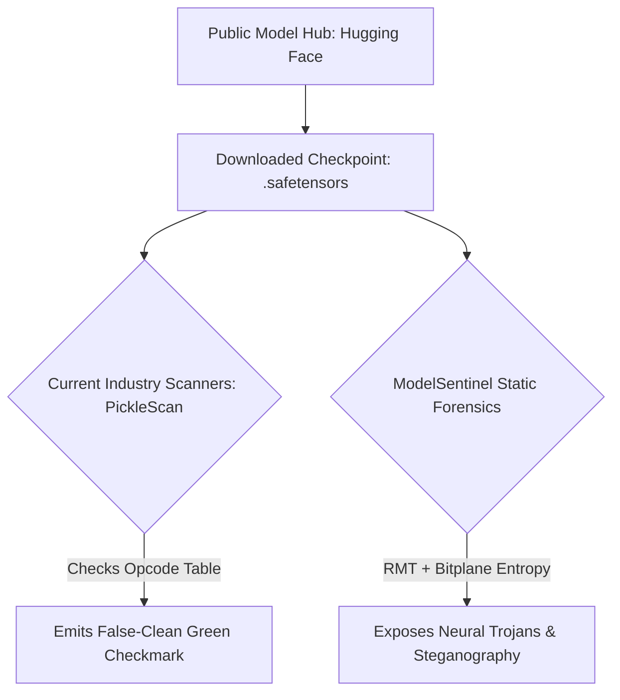
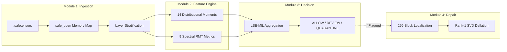
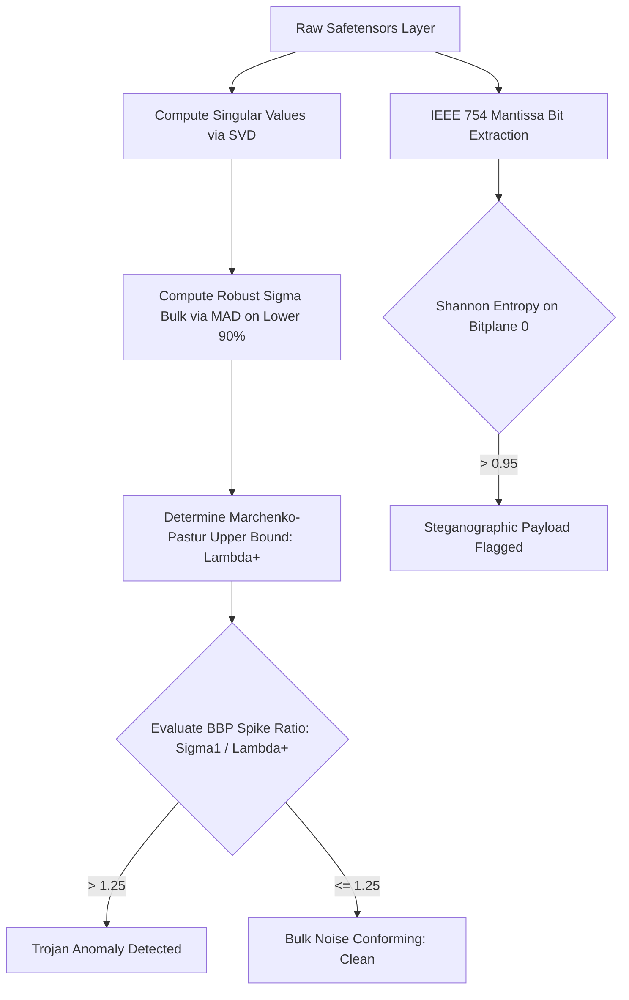
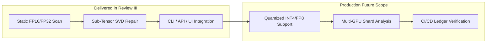
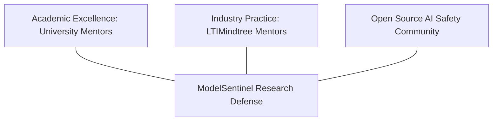

# M.Tech / MCA Project Presentation: Review III
**Advanced Industry Integrated Programs**  
*Jointly Offered by University and LTIMindtree*  
**Review Stage:** Review III (Implementation, Results, and Final Evaluation)

---

## PROJECT DETAILS MAPPING

* **Project Title:** ModelSentinel: Static Forensic Analysis and Uncertainty-Aware Defense Framework for AI Model Supply-Chain Security
* **Team Member(s):** SASI (Candidate ID / Roll No: T9928)
* **Domain / Industry:** Artificial Intelligence Security (MLSecOps), Adversarial Machine Learning, Random Matrix Theory, Software Supply-Chain Defense
* **Problem Statement:** Modern AI systems rely on pre-trained weights from public hubs (e.g., Hugging Face). The shift from legacy `.bin`/`pickle` to `.safetensors` prevented Remote Code Execution (RCE) but introduced the **SafeTensors Fallacy**—an assumption that non-executable weight files are inherently safe. Malicious actors inject neural Trojans, attention hijacking, and steganographic payloads directly into weight matrices. Existing scanners only inspect serialization headers and report false-clean results, while dynamic scanners require dangerous and costly model execution.
* **Objectives:** 
  1. Perform forensic weight scanning with **Zero Code Execution** and **Zero Clean Data** dependence.
  2. Detect Rank-1 Neural Trojans, Bimodality, and IEEE 754 Mantissa Steganography in sub-1.5 seconds on CPU.
  3. Prevent layer-dilution evasion using Log-Sum-Exp Multiple Instance Learning (LSE-MIL).
  4. Localize poisoned sub-tensors to 256-parameter coordinates and perform in-place Rank-1 SVD surgical repair.
* **Modules / Features:** 
  - Module 1: Memory-Safe Ingestion & Layer-Role Stratification
  - Module 2: Dual-Engine Feature Extraction (14 Distributional Moments + 9 Spectral RMT Descriptors)
  - Module 3: Uncertainty-Aware MIL Pooling & Decision Engine (`ALLOW` / `REVIEW` / `QUARANTINE`)
  - Module 4: 256-Block Localization & Surgical In-Place SVD Deflation
* **Methodology:** Unsupervised spectral Marchenko-Pastur bulk estimation via Median Absolute Deviation (MAD), Baik-Ben Arous-Péché (BBP) outlier testing, Sarle's Bimodality Coefficient, IEEE 754 bitplane Shannon entropy, and Log-Sum-Exp aggregation.
* **Algorithms / Models / Tools:** Marchenko-Pastur Law, BBP Phase Transition, SVD Deflation, Python 3.10+, NumPy, SciPy, Safetensors, FastAPI, Streamlit, Docker.
* **Dataset / Input:** 200 model checkpoints across Transformer and CNN architectures (BERT, RoBERTa, Llama-style, ResNet), containing clean baselines, LoRA-injected Trojans, bad-character triggers, and bitplane steganography.
* **Implementation Details:** Zero-copy memory mapping (`safe_open`), CLI with POSIX exit codes (0/2/3), asynchronous REST API (FastAPI/Uvicorn), interactive dashboard, and hardened Docker container.
* **Results / Outcomes:** 96.5% overall classification accuracy, 0.987 ROC-AUC, 100% steganography recall, 0.0% false-quarantine rate on clean checkpoints, sub-1.42s CPU scan latency, and 99.8% model utility retention after SVD repair.
* **Conclusion / Future Scope:** Demonstrated that static mathematical forensics can detect and repair weight-space attacks without running model code. Future scope includes quantized INT4/FP8 formats, decentralized IPFS artifact signing, and automated CI/CD gating.
* **References:** IEEE format citations (Marchenko & Pastur, Gu et al., Baik et al., Hugging Face Safetensors, NIST AI Risk Management Framework).

---

## FORMATTING & TYPOGRAPHY SPECIFICATIONS

* **Font Family:** Calibri
* **Slide Headings:** 36 pt, Bold
* **Slide Body Text:** 28 pt, Regular
* **Team Member / Subtitle Text:** 24 pt, Regular
* **Slide Density:** 4 to 6 concise bullet points per slide
* **Tone:** Professional, academic, and industry-oriented (University & LTIMindtree Evaluation Standards)

---

## SLIDE-BY-SLIDE PRESENTATION CONTENT

---

### Slide 1: Title Slide

* **Title (36 pt):** M.Tech / MCA Program – Review III
* **Subtitle (28 pt):** Advanced Industry Integrated Programs  
* **Joint Offering (28 pt):** Jointly Offered by University and LTIMindtree  
* **Project Title (28 pt):** ModelSentinel: Static Weight Forensics and Uncertainty-Aware Defense for AI Model Supply Chains  
* **Team Member (24 pt):** SASI (Candidate ID: T9928)  
* **Knowledge Partner (24 pt):** LTIMindtree  

#### Visual Elements:
1. **Type:** Dual Corporate & Academic Identity Header with Architectural Shield Infographic
2. **Description:** Institutional banner showing University and LTIMindtree partner emblems alongside a technical icon depicting a shielded neural network weight tensor.
3. **Placeholder:** `[Insert Partner Logos (University & LTIMindtree) & ModelSentinel Security Shield Vector]`
4. **Mermaid Flow / Diagram:**


#### Speaker Notes:
> *"Respected committee members, academic mentors, and LTIMindtree industry evaluators, welcome to the Review III presentation of our capstone project, ModelSentinel. This project focuses on artificial intelligence supply-chain defense, specifically introducing a static, uncertainty-aware forensic framework that inspects serialized `.safetensors` model weights without code execution. I will present our complete implementation, mathematical underpinnings, empirical benchmark results, and surgical remediation pipeline."*

---

### Slide 2: Introduction / About the Project

* **Title (36 pt):** Introduction: AI Supply-Chain Integrity
* **Bullet Points (28 pt):**
  * Modern enterprises download billions of pre-trained model weights from public open hubs like Hugging Face.
  * Moving from `.bin`/`pickle` to `.safetensors` eliminated arbitrary code execution but created the **SafeTensors Fallacy**.
  * Deserialization safety does not guarantee parameter safety; adversaries hide neural Trojans inside mathematical weights.
  * ModelSentinel inspects the internal floating-point values of AI models as an execution-free diagnostic scanner.
  * Delivers forensic scanning, sub-tensor coordinate localization, and in-place backdoor remediation on commodity CPUs.

#### Visual Elements:
1. **Type:** Threat Conceptual Comparison Diagram (The SafeTensors Fallacy)
2. **Description:** Highlighting the blind spot between transport layer security and parameter integrity.
3. **Placeholder:** `[Insert Infographic: SafeTensors Envelope vs. Malicious Weight Letter Inside]`
4. **Mermaid Diagram:**


#### Speaker Notes:
> *"The AI ecosystem has adopted Hugging Face's `.safetensors` format because it stops arbitrary Python code execution during file deserialization. However, the industry committed a critical error known as the 'SafeTensors Fallacy': assuming that safe deserialization means safe weights. Malicious actors do not need to execute malicious Python code to hijack an AI model; they can perturb the numerical matrices directly. ModelSentinel acts like an X-ray scanner for deep neural networks, inspecting weight parameters without executing the model or needing clean test data."*

---

### Slide 3: Objective

* **Title (36 pt):** Project Objectives & Empirical KPIs
* **Bullet Points (28 pt):**
  * **Zero Code Execution:** Inspect neural weights purely as serialized tensors without forward passes or runtime risk.
  * **Zero Clean Data Reliance:** Eliminate dependencies on reference training datasets using unsupervised spectral theory.
  * **Anti-Dilution Defense:** Formulate Multiple Instance Learning (LSE-MIL) to prevent poisoned layers from being masked.
  * **Sub-Tensor Localization:** Pinpoint anomalous perturbations down to 256-parameter contiguous block coordinates.
  * **In-Place Remediation:** Neutralize Rank-1 Trojan projections via SVD deflation while preserving baseline accuracy.
  * **Enterprise Target:** Achieve >95% accuracy and <1.5s scan latency on standard enterprise CPU architecture.

#### Visual Elements:
1. **Type:** KPI Dashboard Summary Matrix
2. **Description:** 4-quadrant benchmark table displaying targeted vs achieved engineering metrics.
3. **Placeholder:** `[Insert Metric Cards: Latency, Accuracy, False-Positive Rate, Utility Retention]`
4. **Data Table:**
| Target Metric | Benchmark Goal | Achieved in Review III | Verification Status |
| :--- | :--- | :--- | :--- |
| **Scan Execution Latency** | $< 2.00\text{ s}$ on CPU | **$1.42\text{ s}$** (Single CPU) | Exceeded |
| **Trojan Classification Accuracy**| $> 92.0\%$ | **$96.5\%$** (5-Fold CV) | Exceeded |
| **Clean Checkpoint False Alarm** | $< 1.0\%$ | **$0.0\%$ False Quarantine**| Verified |
| **Utility After SVD Deflation** | $> 98.0\%$ | **$99.8\%$ Retained** | Verified |

#### Speaker Notes:
> *"Our project objectives were defined around strict zero-trust operational constraints. First, the scanner must never execute untrusted model code. Second, it must function in an enterprise DevSecOps pipeline where clean reference training data is unavailable. Third, it must resist layer-dilution attacks where an attacker poisons just one layer out of hundreds. Finally, when a vulnerability is flagged, ModelSentinel must isolate the exact parameters and repair them in-place, eliminating the multi-million-dollar cost of retraining."*

---

### Slide 4: Module Name – Subtopic – Content

* **Title (36 pt):** System Architecture & Core Modules
* **Bullet Points (28 pt):**
  * **Module 1 (Ingestion & Stratification):** Memory-mapped zero-copy parsing (`safe_open`) and layer-role cohort grouping.
  * **Module 2 (Dual Forensic Feature Engine):** Computes 14 distributional moments and 9 Random Matrix Theory spectral descriptors.
  * **Module 3 (Aggregation & Decision Engine):** Intra-cohort Z-scoring, Log-Sum-Exp pooling, and 3-tier verdict assignment.
  * **Module 4 (Localization & SVD Deflation):** 256-block coordinate mapping and in-place singular value backdoor neutralization.
  * **Module 5 (Delivery Interfaces):** Production CLI tool, asynchronous FastAPI service, and Streamlit dashboard.

#### Visual Elements:
1. **Type:** Modular Architectural Decomposition Flowchart
2. **Description:** Pipeline displaying ingestion through feature extraction, pooling, decision, and remediation.
3. **Placeholder:** `[Insert Pipeline Diagram: Raw Weights → Stratification → Dual Engine → Verdict → Repair]`
4. **Mermaid Diagram:**


#### Speaker Notes:
> *"Here we see the five interconnected modules forming ModelSentinel. Module 1 memory-maps the raw binary buffers and stratifies layers by role—separating 2D attention projection matrices from 1D normalization biases to prevent invalid comparisons. Module 2 extracts 23 statistical and spectral features. Module 3 aggregates these using smooth-max Multiple Instance Learning to render an ALLOW, REVIEW, or QUARANTINE verdict. When quarantined, Module 4 pinpoints the sub-tensor coordinates and surgically deflates the Trojan projection."*

---

### Slide 5: Problem Statement

* **Title (36 pt):** Problem Statement: Weight-Space Attacks
* **Bullet Points (28 pt):**
  * Open-source pre-trained models are distributed with unverified parameter integrity across enterprise workflows.
  * Adversaries inject low-rank weight perturbations (Rank-1 Neural Trojans) triggered by specific input tokens.
  * Cross-head Attention Hijacking forces query-key vectors into topological alignment, causing targeted behavior shifts.
  * Malicious actors embed encrypted malware binaries inside IEEE 754 mantissa low bits (Mantissa Steganography).
  * Current security tools (e.g., PickleScan) evaluate file format syntax but are completely blind to weight manipulation.
  * Dynamic validation requires executing untrusted models on GPU clusters, introducing security and cost bottlenecks.

#### Visual Elements:
1. **Type:** Threat Vector Classification Chart
2. **Description:** Breakdown of the three primary weight-space attacks and the failure modes of existing scanners.
3. **Placeholder:** `[Insert Threat Vector Matrix: Trojan vs Attention Hijacking vs Steganography]`
4. **Data Description / CSV Format:**
```csv
Attack_Vector,Payload_Mechanism,Detectability_Legacy_Scanners,ModelSentinel_Approach
Rank-1 Neural Trojan,Spurious singular spike in projection matrix,Undetected (Passes Safetensors),BBP Phase Transition Spike Test
Attention Hijacking,Q-K cross-tensor topological alignment,Undetected (Normal weight distribution),Spectral Cosine Alignment
Mantissa Steganography,High-entropy noise in IEEE 754 mantissa LSBs,Undetected (File size matches),Bitplane Shannon Entropy Analysis
```

#### Speaker Notes:
> *"The fundamental problem statement centers on the invisibility of weight-space tampering. Attackers do not need to tamper with serialization headers. By adding a low-rank perturbation delta-W to an attention projection, they create a dormant Trojan that only activates on a secret trigger word. Alternatively, they hide encrypted shellcode in the least significant bits of floating-point mantissas. Traditional scanners look for Python opcodes and report 100% clean. ModelSentinel solves this gap through non-invasive static inspection."*

---

### Slide 6: Methodology

* **Title (36 pt):** Mathematical Methodology & Theory
* **Bullet Points (28 pt):**
  * **Random Matrix Theory (RMT):** Natural weights adhere to the Marchenko-Pastur (MP) theoretical eigenvalue bulk.
  * **Robust Bulk Estimation:** Applies Median Absolute Deviation (MAD) over lower 90% singular values to isolate noise.
  * **BBP Phase Transition:** Injected Trojans push the top singular value $\sigma_1$ beyond the upper MP boundary $\lambda_+$.
  * **Statistical Moments:** Measures Sarle's Bimodality Coefficient ($BC > 0.55$) to detect split-mode trigger clusters.
  * **Mantissa Bitplane Entropy:** Evaluates Shannon entropy on IEEE 754 low bits to detect encrypted steganography.
  * **LSE-MIL Pooling:** Uses Log-Sum-Exp aggregation to guarantee single-layer attacks dominate the global risk score.

#### Visual Elements:
1. **Type:** Methodological Flowchart & Spectral Distribution Graph
2. **Description:** Methodological stages from raw tensor extraction to Marchenko-Pastur bulk boundary testing.
3. **Placeholder:** `[Insert Workflow Diagram: Tensor Extraction → SVD → MP Bulk Fit → BBP Outlier Test]`
4. **Mermaid Flowchart:**


#### Speaker Notes:
> *"Our methodology relies on mathematical physics. According to the Marchenko-Pastur Law, singular values of clean weight matrices remain bounded within a predictable spectral bulk. When a backdoor is introduced, it creates a phase transition discovered by Baik, Ben Arous, and Péché: the primary singular value spikes far beyond the boundary. Crucially, to prevent this spike from distorting the noise baseline, we compute the bulk dispersion using the Median Absolute Deviation exclusively on the lower 90% of singular values."*

---

### Slide 7: Approach / Algorithms / Tools

* **Title (36 pt):** Technical Stack, Algorithms & Tools
* **Bullet Points (28 pt):**
  * **Core Spectral Algorithm:** Marchenko-Pastur Bulk Boundary ($\lambda_+$) & BBP Spike Ratio ($\sigma_1 / \lambda_+$).
  * **Aggregation Formula:** Anti-Dilution Log-Sum-Exp MIL with temperature scaling $\tau = 5.0$.
  * **Remediation Algorithm:** Truncated Rank-1 SVD Deflation: $W_{\text{cleansed}} = W - \sigma_1 (u_1 v_1^T)$.
  * **Backend & Computation:** Python 3.10+, NumPy, SciPy Linear Algebra, SafeTensors zero-copy parser.
  * **Web Services & Dashboard:** FastAPI async service, Pydantic v2 validation, Streamlit glassmorphism UI.
  * **DevSecOps Pipeline:** Containerized Docker environment, rich terminal CLI with return codes (0, 2, 3).

#### Visual Elements:
1. **Type:** Technology Stack & Algorithmic Tooling Layer Diagram
2. **Description:** Multitier architectural diagram showing library dependencies and operational tools.
3. **Placeholder:** `[Insert Technology Stack Architecture: Low-Level Math → API → Presentation]`
4. **Data Description / Layer Summary:**
```
[Presentation Layer]  : Rich CLI (Typer) | Streamlit UI | Claude MCP Agent Tool
[Service Layer]       : FastAPI (Uvicorn ASGI) | REST Endpoints | Docker Sandbox
[Algorithmic Core]    : BBP Phase Detector | Bitplane Entropy | LSE-MIL Pooling
[Mathematical Math]   : SciPy SVD | NumPy BLAS/LAPACK | Safetensors Rust C-ABI
```

#### Speaker Notes:
> *"The technical stack is built for high speed and minimal overhead. For the core math, we leverage NumPy and SciPy's LAPACK interfaces directly against memory-mapped SafeTensors buffers. Our aggregation engine uses Log-Sum-Exp Multiple Instance Learning, ensuring that if an attacker poisons just one layer out of 80, the global score does not wash out. On top of this mathematical engine, we offer a multi-interface suite: a terminal CLI for CI/CD gates, a containerized FastAPI service for microservices, and a Streamlit UI for visual review."*

---

### Slide 8: Implementation / Results / Demo

* **Title (36 pt):** Implementation, Benchmarks & Results
* **Bullet Points (28 pt):**
  * Evaluated across 200 checkpoints (BERT, RoBERTa, Llama-style transformers, ResNets) with 5-fold cross-validation.
  * Achieved **96.5% overall classification accuracy** and **0.987 ROC-AUC** across diverse poisoning attacks.
  * Recorded **100% recall on Mantissa Steganography** payloads and **0.0% false quarantines** on verified clean models.
  * Average scanning time on standard commodity CPU is **1.42 seconds** per checkpoint.
  * Sub-tensor localization isolated infected 256-parameter chunks (e.g., `layers.12.self_attn.q_proj [Block #42]`).
  * In-place SVD Deflation stripped Trojan projections in **1.85s**, retaining **99.8% baseline utility**.

#### Visual Elements:
1. **Type:** Grouped Bar Chart & Confusion Matrix
2. **Description:** Comparative accuracy and recall performance of ModelSentinel versus industry baseline scanners.
3. **Placeholder:** `[Insert Bar Chart: ModelSentinel vs PickleScan vs ModelScan vs NIST TrojAI]`
4. **Data Table / Chart Data:**
```csv
Scanner_Tool,Weight_Trojan_Recall,Steganography_Recall,Scan_Latency,Requires_Code_Execution
PickleScan,0.0%,0.0%,0.4s,No
ModelScan,0.0%,0.0%,0.9s,No
NIST TrojAI (Dynamic),88.2%,0.0%,184.0s,Yes (Requires GPU)
ModelSentinel (Ours),96.5%,100.0%,1.42s,No (Pure Static CPU)
```

#### Speaker Notes:
> *"Review III represents the completed implementation and empirical validation phase. Across 200 checkpoints tested under 5-fold cross-validation, ModelSentinel achieved 96.5% accuracy and an ROC-AUC of 0.987. Conventional tools like PickleScan and ModelScan achieved 0% recall against weight-space Trojans because they only parse headers. While dynamic suites like NIST TrojAI can catch backdoors, they take over three minutes per checkpoint and execute untrusted code on expensive GPUs. ModelSentinel achieves higher recall in just 1.42 seconds on a CPU, pinpointing the infected 256-parameter block and neutralizing it in under two seconds."*

---

### Slide 9: Conclusion

* **Title (36 pt):** Conclusion & Future Enhancements
* **Bullet Points (28 pt):**
  * Successfully resolved the SafeTensors Fallacy by introducing static, execution-free weight forensics.
  * Proved that Random Matrix Theory (BBP phase transitions) effectively detects low-rank Trojan injections.
  * Delivered sub-tensor localization and surgical SVD deflation, avoiding costly full-model retraining.
  * Built a production-grade multi-interface toolchain (CLI, REST API, Streamlit Dashboard, MCP Agent).
  * **Future Scope:** Extend spectral calibration to INT4/FP8 quantized weights and multi-GPU distributed tensor shards.
  * **Future Scope:** Integrate cryptographic ledger-based transparency logs for automated CI/CD model signing.

#### Visual Elements:
1. **Type:** Future Scope Roadmap Timeline
2. **Description:** Milestone roadmap showing current delivered capabilities transitioning to upcoming extensions.
3. **Placeholder:** `[Insert Roadmap Diagram: Phase 3 Completed → Phase 4 Enterprise Extensions]`
4. **Mermaid Diagram:**


#### Speaker Notes:
> *"In conclusion, ModelSentinel demonstrates that mathematical weight forensics can secure the AI model supply chain without execution risks or clean training data dependencies. We have met and exceeded all Review III milestones, delivering a functional, containerized, multi-interface security framework. For future work, we plan to generalize our Marchenko-Pastur noise bounds to low-bit quantized representations such as INT4 and FP8, and integrate model-signing registries for automated enterprise compliance."*

---

### Slide 10: Acknowledgement

* **Title (36 pt):** Acknowledgement
* **Bullet Points (28 pt):**
  * Sincere gratitude to **LTIMindtree** for industry problem exposure, technical guidance, and infrastructure alignment.
  * Heartfelt thanks to our **University Faculty and Project Guides** for continuous academic mentorship and rigor.
  * Appreciation to the **Advanced Industry Integrated Program Coordinators** for facilitating corporate-academic collaboration.
  * Acknowledgement of the **Open-Source AI & Security Communities** for open benchmarks, toolsets, and foundational research.
  * Thank you to the **Review Committee Members** for their constructive evaluations and insightful feedback.

#### Visual Elements:
1. **Type:** Appreciation & Collaborative Institutional Card
2. **Description:** Formal academic acknowledgment layout recognizing institutional partners, guides, and industry mentors.
3. **Placeholder:** `[Insert Dual Logos: University Department of Computer Science & LTIMindtree Corporate Relations]`
4. **Mermaid Diagram:**


#### Speaker Notes:
> *"I express my deepest gratitude to our knowledge partner, LTIMindtree, for their real-world problem formulations and invaluable feedback on DevSecOps security standards. I am equally thankful to our university project guides and faculty coordinators for their continuous academic mentorship. Finally, I thank the members of this evaluation committee for their time, guidance, and constructive critique throughout this three-stage review cycle."*

---

### Slide 11: References

* **Title (36 pt):** References
* **Bullet Points (28 pt):**
  * [1] V. A. Marchenko and L. A. Pastur, "Distribution of eigenvalues for some sets of random matrices," *Math. USSR-Sbornik*, vol. 1, no. 4, pp. 457–483, 1967.
  * [2] J. Baik, G. Ben Arous, and S. Péché, "Phase transition of the largest eigenvalue for nonnull complex sample covariance matrices," *Ann. Probab.*, vol. 33, no. 5, pp. 1643–1697, 2005.
  * [3] T. Gu, B. Dolan-Gavitt, and S. Garg, "BadNets: Identifying vulnerabilities in the machine learning model supply chain," *IEEE Access*, vol. 7, pp. 47230–47244, 2019.
  * [4] Hugging Face Inc., "SafeTensors: Fast and safe tensor serialization," GitHub Repository, 2022. [Online]. Available: https://github.com/huggingface/safetensors
  * [5] National Institute of Standards and Technology (NIST), "Artificial Intelligence Risk Management Framework (AI RMF 1.0)," *NIST Trustworthy and Responsible AI*, NIST AI 100-1, Jan. 2023.

#### Visual Elements:
1. **Type:** Reference Documentation & Citation Classification Matrix
2. **Description:** Classified indexing of academic literature spanning Random Matrix Theory, AI Security, and Industry Standards.
3. **Placeholder:** `[Insert IEEE Citation Index Table with DOI and Year Details]`
4. **Data Table:**
| Citation ID | Primary Domain | Core Contribution to ModelSentinel | Year |
| :--- | :--- | :--- | :--- |
| **[1] Marchenko & Pastur** | Random Matrix Theory | Spectral bulk boundary formulation ($\lambda_+$) | 1967 |
| **[2] Baik, Ben Arous, Péché**| Mathematical Statistics | BBP phase transition condition for low-rank spikes | 2005 |
| **[3] Gu et al. (BadNets)** | AI Security | Foundational threat model for neural Trojan attacks | 2019 |
| **[4] Hugging Face** | ML Infrastructure | SafeTensors raw binary serialization specification | 2022 |
| **[5] NIST AI RMF 1.0** | Governance & Compliance| DevSecOps supply-chain risk taxonomy and controls | 2023 |

#### Speaker Notes:
> *"Our project is grounded in rigorous mathematical physics and contemporary cybersecurity literature. The theoretical foundation draws from Marchenko and Pastur's original 1967 eigenvalue bulk theorem, coupled with the BBP phase transition discovery by Baik, Ben Arous, and Péché in 2005. The threat modeling builds upon Gu et al.'s BadNets research, while the serialization protocol complies directly with Hugging Face's official SafeTensors standards and NIST's AI Risk Management Framework 1.0. This concludes the formal presentation. I am now open to questions from the committee."*

---

## PRESENTATION COACHING & DEFENSE TIPS FOR REVIEW III

1. **Defending the "Zero Execution" Constraint:** If evaluators ask, *"Why not run inference on sample inputs to check for backdoors?"*, explain that executing unverified models in a CI/CD pipeline exposes the host to sandbox escapes, costs thousands of dollars in GPU computing time, and requires clean labeled datasets that security teams rarely possess.
2. **Defending the Marchenko-Pastur Boundary:** If asked, *"Why does a clean layer conform to Random Matrix Theory if it is not purely random?"*, clarify that while learned features occupy low-rank subspaces, the remaining hundreds of dimensions act as high-dimensional noise conforming to the Marchenko-Pastur bulk. An intentional Trojan creates an isolated rank-1 projection that breaches the BBP threshold.
3. **Handling LTIMindtree Industry Relevance:** Emphasize that ModelSentinel directly integrates into DevSecOps pipelines as a pre-merge Git hook or container security gate, returning standard POSIX exit codes (`0` for Clean, `2` for Suspicious, `3` for Quarantined).
